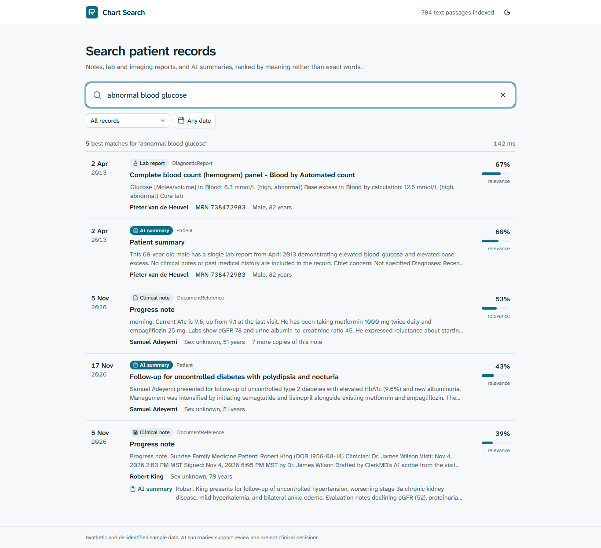
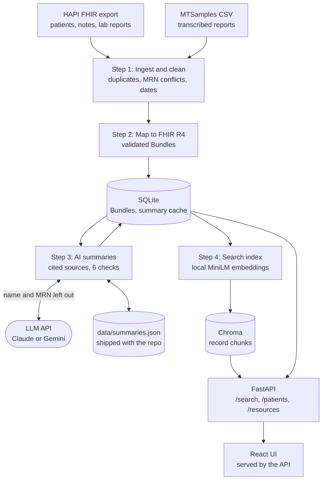
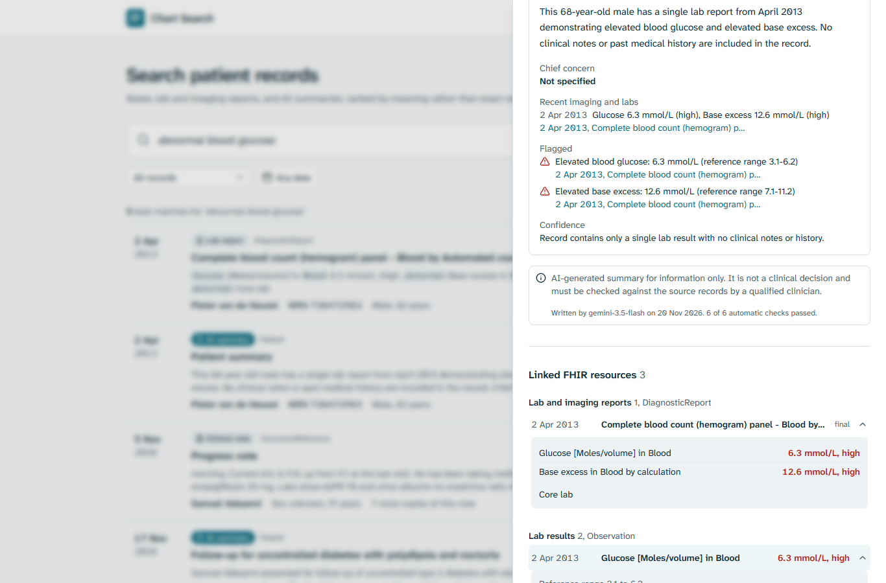
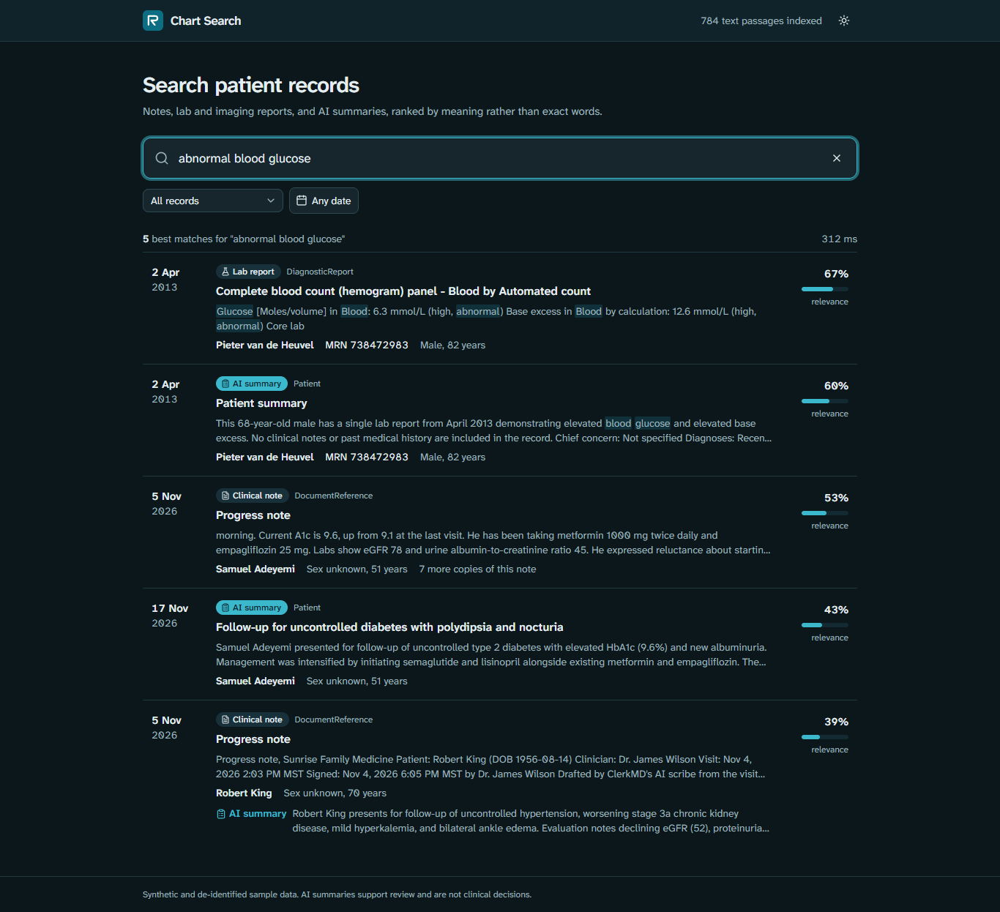
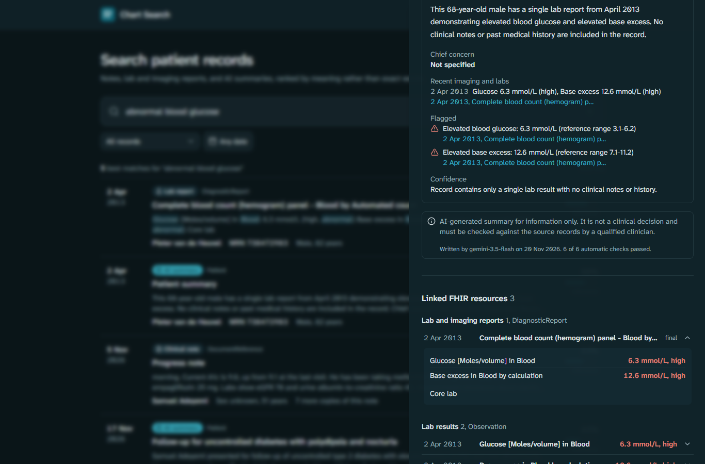
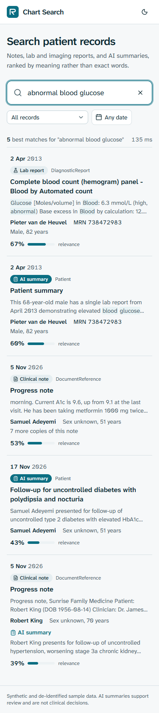

# EHR Media Intelligence Platform

[](https://github.com/surafel58/ehr-media-intelligence/actions/workflows/ci.yml)

Cleans raw EHR exports, maps them to FHIR R4, writes AI summaries per patient, and makes every record searchable in plain language.



## Quick start

**Demo video (47 seconds):** [docs/demo.mp4](docs/demo.mp4) shows a search, the patient drawer with its AI summary and lab values, the record type filter, and the dark theme.

Needs Python 3.11+ with [uv](https://docs.astral.sh/uv/), and Node 20+ with [pnpm](https://pnpm.io/) for the UI.

```bash
git clone https://github.com/surafel58/ehr-media-intelligence
cd ehr-media-intelligence
uv sync
cd frontend && pnpm install && pnpm build && cd ..
uv run python -m ehr_platform.demo
```

Then open http://127.0.0.1:8000. The demo command cleans the raw data, maps it to FHIR, loads the AI summaries and builds the search index, then starts the app. The first run takes a few minutes because it downloads the embedding model.

No API key is needed: the AI summaries generated for this data ship in `data/summaries.json`. They are matched to each patient by a hash of their records, so they only appear while the records are unchanged.

### Searches to try

| Search | Expected top results |
|---|---|
| abnormal blood glucose | A blood count with high glucose and base excess, and that patient's AI summary |
| heart failure with a leg wound | Home health notes and the AI summary for a patient with heart failure and a leg ulcer |
| bone scan for prostate cancer | The AI summary of a bone scan for prostate cancer, then the bone scan report and a prostate pathology report |
| headache with visual aura | Progress notes about migraine with aura |
| chronic pain on opioids | The AI summary and notes of a patient on gabapentin and oxycodone |

Click a result to open the patient: banner, AI summary with its sources, and every linked FHIR resource.

### Other ways to check search

| How | Command or link |
|---|---|
| From the terminal | `uv run python -m ehr_platform.search --query "abnormal blood glucose"` |
| API docs | http://127.0.0.1:8000/docs, then `POST /search` and "Try it out" |
| Backend tests | `uv run pytest` |
| Browser tests | `cd frontend && pnpm exec playwright install chromium && pnpm e2e` |

### Example output

Two patients from the sample data, as stored after step 3. No install needed to read them.

| Patient | FHIR R4 Bundle | AI summary |
|---|---|---|
| Headaches with visual aura: 8 visits and notes, gender and MRN missing | [notes-patient-bundle.json](docs/examples/notes-patient-bundle.json) | [notes-patient-summary.json](docs/examples/notes-patient-summary.json) |
| Abnormal blood glucose: a lab report with two high results | [lab-patient-bundle.json](docs/examples/lab-patient-bundle.json) | [lab-patient-summary.json](docs/examples/lab-patient-summary.json) |

Each summary cites the record ids it came from and lists the result of every quality check. Note text sits base64 encoded in `attachment.data`, as FHIR requires.

## Architecture



Steps 1 to 4 build the data once. The app only reads it: FastAPI searches Chroma, then loads the records and summaries from SQLite.

| Data | Leaves the machine |
|---|---|
| Patient name and MRN fields | Never. They are left out of the summary prompt, though a note's own text can still mention the name. |
| Record text | Only to write summaries, sent to Claude or Gemini as written. With the shipped summaries, nothing is sent. |
| Search queries | Never. Embeddings run locally for indexing and for queries. |

## Progress

| Step | Status | Code |
|---|---|---|
| 1. Ingestion and cleaning | Done | `src/ehr_platform/ingestion/` |
| 2. FHIR R4 mapping | Done | `src/ehr_platform/fhir_mapping/` |
| 3. AI summaries | Done | `src/ehr_platform/summarization/` |
| 4. Semantic search | Done | `src/ehr_platform/search/`, `src/ehr_platform/api/` |
| 5. Frontend | Done | `frontend/` |

## Step by step

Requires Python 3.11+ and [uv](https://docs.astral.sh/uv/). Plain pip also works with `pip install -r requirements.txt` (it pulls the CPU-only PyTorch build).

```bash
uv sync
cp .env.example .env                         # add ANTHROPIC_API_KEY (or GEMINI_API_KEY)
uv run python -m ehr_platform.ingestion      # step 1
uv run python -m ehr_platform.fhir_mapping   # step 2
uv run python -m ehr_platform.summarization  # step 3
uv run python -m ehr_platform.search         # step 4: build the index
uv run python -m ehr_platform.api            # step 4: API on http://127.0.0.1:8000/docs
uv run pytest

cd frontend && pnpm install && pnpm build    # step 5: the API then serves the UI at http://127.0.0.1:8000
```

## Data

All data is synthetic or de-identified sample data. No real patients.

### Sources used

| Source | Format | Contents | Why |
|---|---|---|---|
| [HAPI FHIR public test server](https://hapi.fhir.org/) | FHIR JSON | Patients, clinical notes, visits, lab reports | Open server where many developers upload test data with no review, so the data is messy on its own. Notes are linked to patients. |
| [MTSamples](https://github.com/aneuraz/mtsamplesFR) | CSV | Transcribed reports: radiology, discharge, progress notes and more | 4,999 reports with detailed clinical text. Public domain (CC0). |

### Sources checked and not used

| Source | Reason |
|---|---|
| Oracle Health (Cerner) open sandbox | Strong duplicate and ID problems, but 0 of 29 sampled notes had real clinical text. Most were PDFs only, placeholder text or test junk. |
| [Synthetic OMOP dataset (Zenodo)](https://zenodo.org/records/23913660) | PostgreSQL dump with no notes. Covers only placeholder birth dates. |
| Synthea | Clean data. Nothing to clean. |
| MIMIC-IV | Real patient data. |

### Problems found in the raw data

| Problem | HAPI snapshot | MTSamples |
|---|---|---|
| Duplicates | 11 extra patient records in 6 groups. "Robert Smith, 1972-11-02" stored 3 times. | 2,609 duplicate copies in the full file (34 in our subset). The same report is filed under several specialties. |
| Conflicting IDs | "John Smith, 1980-01-15" stored under 4 different MRNs | None. Reports have no patient ID. |
| Missing fields | 21 of 42 patients without gender, 8 without birth date, 4 without a name | 33 empty reports in the full file (3 in our subset) |
| Mixed date formats | Times with offsets `-04:00` and `-05:00`. In note text: `2024-03-16`, `03/16/2024`, `Nov 9, 2026`, `12 Apr 2024` | `2/11/92`, `07/24/2008`, `January 16, 2008`, `7/2008` |
| Inconsistent values | MRNs like `MRN-100002`, `MRN100001`, `CLR-12345`. Names like `smith`, `SMITH`, `Abe604`. 120 lab results with codes but no names. | Stray spaces in every specialty value. Line breaks replaced by commas. |
| Wrong data | A note states age 92 for a patient whose birth date makes her 82 | |
| Not clinical | All notes with no patient link were CSV code lists | |

### How patients are handled

| Case | Rule |
|---|---|
| Same full name and birth date | Merge into one patient. Keep all old IDs. Flag if MRNs differ. |
| Same MRN, different name or birth date | Do not merge. Flag the conflict. |
| Same first and last name, middle name differs | Do not merge. Flag as possible duplicate. |
| Same name, no birth date | Do not merge. Flag as possible duplicate. |
| Note with no patient link | Kept out of patient records. Listed as unlinked in the report. |
| MTSamples report | One patient per report after removing duplicates. Age and sex taken from the text. Name and birth date left empty. |

## Step 1: Ingestion and cleaning

```bash
uv run python -m ehr_platform.ingestion
```

Reads `data/raw/` and writes `var/clean/`: `patients.json`, `encounters.json`, `documents.json` and `report.json`.

### Input

| File | Contents | Rebuild with |
|---|---|---|
| `data/raw/hapi_export.json` | Snapshot from 2026-11-20: 42 patients, 137 notes, 114 visits, 6 lab reports, 123 lab results | `scripts/fetch_hapi.py` |
| `data/raw/mtsamples.csv` | 70 rows: 33 reports from 6 specialties, every duplicate copy of them, and 3 empty rows | `scripts/fetch_mtsamples.py` |

The HAPI snapshot keeps only the fields the pipeline uses. Addresses, phone fields and SSN identifiers are removed. SSN and Medicare numbers inside note text are masked.

### Cleaning rules

| Problem | Rule |
|---|---|
| Date formats | 12 formats parsed to ISO 8601. Slash dates read as month/day unless the first number is over 12. Two digit years never land in the future. Partial dates keep their precision (`2008-07`). |
| Time zones | All times converted to UTC. Times with no offset are marked as assumed UTC. |
| Gender | `M`, `F`, `1`, `2`, `woman`, `gentleman` and similar mapped to `male`, `female`, `other`, `unknown`. Missing becomes `unknown`. |
| Names | Spaces trimmed, all caps and all lower case fixed, generator digits removed (`Abe604` to `Abe`). |
| MRNs | Best MRN picked from all identifiers, skipping UUIDs and SSNs. Prefix and separators removed (`MRN-100002` to `100002`). |
| Duplicate documents | Same text when case, spacing and punctuation are ignored. First copy kept. Ids and specialties of the other copies added to it. |
| Note text | Base64 decoded (twice when needed). HTML stripped. MTSamples line breaks restored. Missing titles taken from the first line. |
| Lab results | Missing names filled from LOINC codes. Units fixed (`mmol/l` to `mmol/L`). High or low worked out from the reference range when not given. |
| Note vs record | Name, birth date and age written in a note are checked against the linked patient. |
| Unusable records | Empty reports and non-note attachments are dropped with a reason. |

### Result

| | Raw | Clean |
|---|---|---|
| Patients | 42 HAPI records, 70 MTSamples rows | 64 (31 HAPI, 33 MTSamples) |
| Documents | 143 HAPI, 70 MTSamples | 172 (154 notes, 10 lab reports, 8 imaging reports) |
| Duplicate patients merged | | 11 records into 6 patients |
| Duplicate documents removed | | 34 |
| Dropped | | 7 (3 empty reports, 4 CSV code lists) |

### Flags for review

| Flag | Records | Meaning |
|---|---|---|
| `missing_gender` | 39 | No gender in the source |
| `missing_date` | 34 | No document date found |
| `identity_unknown` | 33 | MTSamples report with no name or MRN |
| `missing_mrn` | 21 | No identifier that looks like an MRN |
| `missing_birth_date` | 8 | |
| `possible_duplicate` | 5 | Same name, but birth date missing or middle name differs |
| `missing_name` | 4 | |
| `conflicting_mrn` | 2 | Merged records carried different MRNs |
| `note_age_mismatch` | 1 | Note says age 92, birth date gives 82 |

Every record has an `audit` list. Each entry holds the field, the rule applied, and the value before and after. `report.json` lists totals, merges, conflicts and dropped records.

### Tests

71 tests: date formats, gender codes, names, MRNs, text repair, patient matching, document de-duplication, and a full run on a small hand-made dataset.

## Step 2: FHIR R4 mapping

```bash
uv run python -m ehr_platform.fhir_mapping
```

Reads `var/clean/`. Writes one Bundle per patient to `var/fhir/bundles/` and `var/ehr.db`, and the validation report to `var/fhir/validation_report.md`.

### Mapping

| Clean record | FHIR resource | Details |
|---|---|---|
| Patient | `Patient` | MRN typed as `MR`, other IDs kept. Flags from step 1 kept as `meta.tag`. Age stated in a note kept as an extension. |
| Visit | `Encounter` | Each MTSamples report gets one derived visit, tagged `derived`. |
| Note | `DocumentReference` | LOINC type from the title: progress note, discharge summary, history and physical, consult, ED note. Text stored as an attachment. |
| Lab or imaging report | `DiagnosticReport` | Category `LAB` or `RAD`. Conclusion taken from the IMPRESSION, CONCLUSION or DIAGNOSIS section. |
| Lab result | `Observation` | LOINC code, value, unit, reference range, and `H` or `L` flag. |

Each Bundle is a `collection`. Entries use `urn:uuid` addresses, and every `subject`, `encounter` and `result` reference points to an entry in the same Bundle.

### Validation

| Check | How |
|---|---|
| Structure and data types | fhir.resources R4B models |
| Required codes | Gender and status values checked against the allowed codes. fhir.resources does not check these: it accepts gender `M`. |
| Required fields | `status`, `class`, `code`, `content` |
| References | Every reference must resolve to an entry in the Bundle |
| Warnings | Valid but incomplete: no date, name, identifier or birth date |

### Result

| Bundles | Valid | Resources | Errors | Warnings |
|---|---|---|---|---|
| 64 | 64 | 506 | 0 | 188 |

| Resource | Count |
|---|---|
| Patient | 64 |
| Encounter | 147 (114 from HAPI, 33 derived) |
| DocumentReference | 154 |
| DiagnosticReport | 18 |
| Observation | 123 |

The raw HAPI snapshot also passes the same checks: 422 resources, 0 errors. Its problems are in the content (duplicates, conflicting IDs, missing values), not the structure, so cleaning has to run before mapping.

Most warnings come from MTSamples patients, which have no name, identifier or birth date. MTSamples has no status field, so its notes are set to `current` and its reports to `unknown`. The report lists each of these 33 defaults.

### FHIR version

fhir.resources 8, the release built on Pydantic v2, ships R5 and R4B models but not R4. Bundles are validated with the R4B models. R4B changed subscriptions, medication definitions and evidence resources. The five resources used here are the same in R4 and R4B.

### Storage

SQLite at `var/ehr.db`:

| Table | Holds |
|---|---|
| `bundles` | One row per patient: Bundle JSON, valid flag, error and warning counts |
| `resources` | Every resource by type, id and patient, for direct lookups |

### Tests

15 tests: resource mapping, references, status defaults, lab results, derived visits, the validator catching bad codes, missing fields, broken references, bad dates and duplicate entries, and the SQLite store.

## Step 3: AI summaries

```bash
uv run python -m ehr_platform.summarization                       # Claude (default)
uv run python -m ehr_platform.summarization --provider gemini     # Gemini
uv run python -m ehr_platform.summarization --dry-run             # what would be sent, rough cost
uv run python -m ehr_platform.summarization --cached-only         # saved summaries only, no API calls
```

Reads the Bundles from `var/ehr.db`. Writes one summary per patient to `var/summaries/` and the SQLite cache, plus `var/summaries/quality_report.md`.

### Summary contents

| Field | Content |
|---|---|
| `overview` | Two or three sentences for a search result |
| `chief_concern` | Main reason for the most recent care |
| `key_diagnoses` | Up to 5, each with the ids of the records that support it |
| `recent_media` | Up to 5 recent imaging, lab and pathology records, one line each |
| `anomalies` | Up to 5 abnormal results or record contradictions, marked `clinical` or `data_quality` |
| `confidence` | `high`, `medium` or `low`, with a one-sentence reason |
| `disclaimer` | Fixed text added by code, not by the model: AI-generated, not a clinical decision |

### How the prompt keeps summaries short and accurate

| Rule | How |
|---|---|
| Fixed format | Structured output: the model must return the schema above |
| Grounded | Only facts written in the records. Thin or non-clinical records are called out, not filled in. |
| Traceable | Every record in the prompt carries its id. Diagnoses, media and anomalies must cite ids. |
| Short | Target 180 words. A summary over 200 words is regenerated once with a request to shorten it. |
| Minimum data | Names and MRNs are not sent. Sex, birth date and the records are enough. |
| No wasted calls | Patients with no notes or reports get a fixed "no clinical records" summary without an API call. |

### Cache

SQLite table `summaries`, keyed by patient id, record hash, model and prompt version. The record hash covers every resource in the patient's Bundle, so a summary is only regenerated when a record changes or the prompt changes.

### Quality checks

Every summary is checked automatically. These checks are how summary quality was validated.

| Check | Fails when |
|---|---|
| `under_word_limit` | Over 200 words |
| `citations_exist` | A cited id is not a record of this patient |
| `findings_cited` | A diagnosis or clinical anomaly cites nothing |
| `numbers_grounded` | A number or date is not in the records (ages worked out from the birth date are allowed) |
| `abnormal_results_reported` | A lab report with a high or low value is missing from the anomalies |
| `data_quality_reported` | A data quality flag from step 1 is not mentioned |

### Providers

| Provider | Default model | Notes |
|---|---|---|
| Claude | `claude-opus-5-5` | Default. Server-side refusal fallback turned on. |
| Gemini | `gemini-3.5-flash` | Free tier: 20 requests per day per model. Rate limits are retried with a wait. |

The sample run uses Gemini because no paid Claude credit was available. Both providers use the same prompt, schema, cache and checks. The Gemini free tier may use prompts to improve Google products, which is fine for synthetic data but not for real patient data.

### Result

The free tier allows 20 summaries per day, so the sample run took four days (Nov 20 to 23).

| Patients | AI summaries | No records (no call) | Failed |
|---|---|---|---|
| 64 | 55 | 9 | 0 |

| Check | Passed |
|---|---|
| All 6 checks | 50 of 55 summaries |
| Words | 51 to 141, median 91 |
| Confidence | 12 high, 36 medium, 7 low |

All 5 misses come from the number check, which only accepts numbers exactly as the note writes them. Three have dates rewritten in ISO form (01/28/08 as 2008-01-28, 6/10/2009 as 2009-06-10, and similar). One is "3-1/2 years" written as 3.5. The last is an ultrasound read as "about 33-34 weeks" where the note gives three measures of 33 weeks and 0 to 6 days: a rounded range, not an invented number.

The summaries also caught problems step 1 missed, such as a patient with eight near-identical progress notes and a note dated 2026 for a 2024 care episode.

### Tests

22 tests with a fake model client, so no API key is needed: context building, cache hits and misses, the length retry, every quality check, refusals and blocked responses, and rate-limit retries.

## Step 4: Semantic search

```bash
uv run python -m ehr_platform.search   # build the index, print search timings
uv run python -m ehr_platform.api      # serve the API
```

```bash
curl -X POST "http://127.0.0.1:8000/search?resource_type=DiagnosticReport&date_from=2013-01-01&date_to=2013-12-31" \
  -H "Content-Type: application/json" -d '{"query": "abnormal blood glucose"}'
```

### Index

| Part | Choice |
|---|---|
| Embeddings | `all-MiniLM-L6-v2` (sentence-transformers), run locally on CPU. Record text never leaves the machine. |
| Vector store | Chroma, saved in `var/chroma`, cosine distance |
| What is indexed | Every note and report (text, conclusion, lab results as text) and every AI summary |
| Chunks | 150 words with a 30-word overlap, title in front. The model reads at most 256 word pieces. |
| Filter fields | Resource type and date stored on every chunk. Dates as `YYYYMMDD` numbers, since Chroma filters only compare numbers. |

### Ranking

| Rule | Why |
|---|---|
| Score = 75% cosine similarity + 25% keyword overlap | Embeddings miss exact clinical words. "Abnormal blood glucose" ranked a genetics panel above the high glucose result until keywords were added. |
| Best chunk per record | A long note matches on its most relevant part |
| Copies collapsed | Notes of one patient with the same matching text show once. The others are listed in `similar_records`. |
| At most 2 records per patient (`per_patient`) | One long chart cannot fill all 5 results |

### API

| Endpoint | Purpose |
|---|---|
| `POST /search` | Body `{"query": "..."}`. Query parameters: `resource_type` (`DocumentReference`, `DiagnosticReport`, `Patient` for AI summaries), `date_from`, `date_to`, `limit` (default 5), `per_patient` (default 2). Returns ranked records with score, snippet, patient name and MRN, and the patient's AI summary overview. |
| `GET /patients/{id}` | Patient details, full AI summary with disclaimer and quality checks, and every linked FHIR resource |
| `GET /resources/{type}/{id}` | One FHIR resource with its attachment text decoded, and for a report, its result values |
| `GET /health` | Index size and model |

Interactive docs at `http://127.0.0.1:8000/docs`.

### Result

227 records (154 notes, 10 lab reports, 8 imaging reports, 55 AI summaries) indexed as 784 chunks.

| Measure | Median | Slowest |
|---|---|---|
| Search inside the index (30 queries) | 26 ms | 48 ms |
| Full API request over HTTP (20 queries) | 45 ms | 67 ms |

The model loads once at startup (about 6 seconds), not per request.

### Known limits

| Limit | Example |
|---|---|
| Negation | "Shortness of breath and chest pain" also matches an ER note that says the patient denies both |
| Near-duplicate notes | Notes with small differences are not collapsed, only exact matching text |

### Tests

18 tests: chunking, records, ranking, both filters, collapsing copies, the per-patient cap, a 50-record speed test, and every endpoint including bad input.

## Step 5: Frontend

```bash
cd frontend
pnpm install
pnpm build    # the API serves the built UI at http://127.0.0.1:8000
pnpm dev      # or: dev server on http://127.0.0.1:5173, API calls proxied to port 8000
```

### Stack

| Part | Choice |
|---|---|
| App | React 19, TypeScript, Vite |
| Styling | Tailwind CSS v4, shadcn/ui on Radix primitives |
| Data | Fetch API through SWR: cached, de-duplicated requests |
| Font | Atkinson Hyperlegible Next, made for low-vision legibility, self-hosted |
| Package manager | pnpm |

### Design

| Choice | Why |
|---|---|
| The search field is the main element | Clinicians come to search. Results update as they type (250 ms pause). |
| Results as chart entries, not cards | A date column, the record, and patient identity on every result, so the right patient is always clear |
| Patient banner at the top of the drawer | Name, MRN, sex, birth date and data quality flags first, as in an EHR |
| AI text is always labeled | "AI summary" label on result entries, a separate panel in the drawer with the disclaimer, the model name and how many checks passed. Each summary appears once per result list. |
| Abnormal values in red with the word | "6.3 mmol/L, high". Color is never the only signal. |
| Light and dark themes | Cool clinical white and deep teal night. The choice is saved, and set before first paint so nothing flashes. |

| | |
|---|---|
|  |  |
|  |  |

### Features

| Feature | Detail |
|---|---|
| Search | Calls `POST /search` as you type. Query words highlighted in each snippet. |
| Result entry | Patient name and MRN, sex and age, record date, type badge with the FHIR resource type, relevance score, AI summary snippet, count of copies of the same note |
| Patient drawer | Full AI summary with disclaimer. Every diagnosis and anomaly links to the record it cites. Linked FHIR resources grouped by type; each opens to show its text or lab values. |
| Filters | Record type (all, notes, lab and imaging reports, AI summaries) and a date range picker |
| States | Loading skeletons, a start screen with example searches, a "no matches" screen that suggests what to change, and a clear error when the API is down |
| Keyboard | `/` focuses search, arrow keys move between results, Enter opens, Escape closes or clears |
| Accessibility | Labels on every control, live region announcing result counts, visible focus rings, headings in order, reduced motion respected |

### Performance

| Measure | Value |
|---|---|
| First load (gzip) | 130 KB JavaScript, 11 KB CSS |
| Loaded on demand | Patient drawer (7 KB) and date calendar (21 KB), preloaded on hover or focus |
| Patient details | Preloaded when a result is hovered or focused, so the drawer opens with data |

### Tests

```bash
cd frontend
pnpm exec playwright install chromium   # once, or point PW_BROWSER_PATH at an installed Chrome, Edge or Brave
pnpm e2e
```

19 Playwright tests in `frontend/e2e/`, run against the real API and data. They fail on any browser console error.

| Test | Checks |
|---|---|
| Start screen | Heading, search focused, example searches, index status |
| Results | Up to 5, sorted by relevance, every field present, query words highlighted, result count announced |
| AI summary snippets | Shown on result entries |
| Example searches | Run a search |
| Keyboard | `/`, arrow keys, Enter, Escape |
| Patient drawer | Banner, AI summary, disclaimer, check count, linked resources, lab values |
| Citations | Open the cited record |
| Type filter | Only `DiagnosticReport` results |
| Date filter | Empty result screen, then clearing filters |
| Service down | Error message and retry button |
| Theme | Dark theme toggles and is remembered after reload |
| Phone width | No sideways scrolling, full-width drawer |
| Screen widths | 320, 375, 768, 1024, 1440 and 1920 px: no sideways scrolling on the page or inside the drawer, date picker fits on screen, drawer full width on phones and a side panel above 640 px |
| Accessibility | axe-core scan (WCAG 2.2 AA rules): no serious or critical issues on results and drawer, light and dark |
